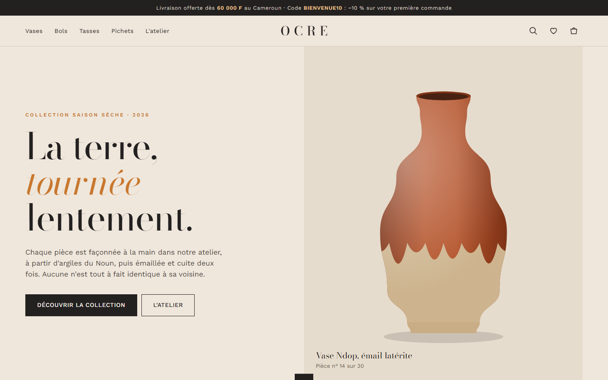
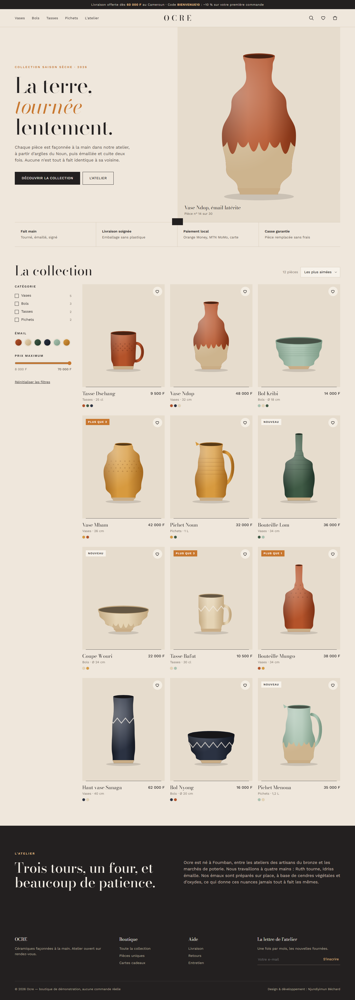
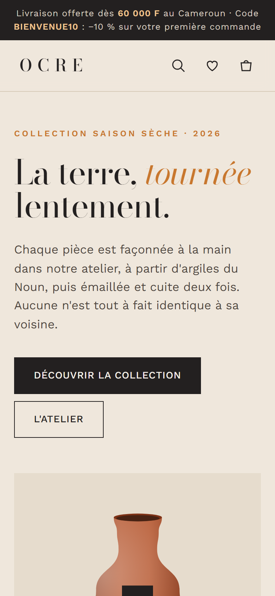

# Ocre

**E-commerce · Boutique** — Boutique en ligne d'un atelier de céramique : catalogue filtrable, fiches produit à variantes, panier persistant, codes promo, livraison par zone et paiement en trois étapes.

**Démo en ligne : [https://lordlennyx.github.io/ocre-boutique/](https://lordlennyx.github.io/ocre-boutique/)**

Spot de présentation (30 s) : [media/spot-30s.mp4](https://lordlennyx.github.io/ocre-boutique/media/spot-30s.mp4)

## Ce que le projet montre

- Visuels produits générés en SVG à partir de profils de tournage et d'émaux (12 pièces, 6 émaux, motifs)
- Filtres combinés (catégorie, émail, prix), tri, recherche instantanée, favoris
- Fiche produit : changement d'émail en direct, quantité limitée au stock, alerte de rareté
- Panier latéral sauvegardé (localStorage), barre de livraison offerte, codes BIENVENUE10 et ATELIER15
- Tunnel de commande en 3 étapes avec validation, zones de livraison, Orange Money / MTN MoMo / carte / à la livraison

## Réalisation

- **Stack :** HTML, CSS, JavaScript natif, SVG procédural
- **Typographies :** Bodoni Moda, Work Sans
- **Prêt pour :** branchement Shopify, WooCommerce ou API NotchPay / CinetPay

| Bureau | Mobile |
|---|---|
|  |  |

---

Client et contenus fictifs, créés pour la démonstration. Conception, design et développement : **Njundiyimun Béchard** — [github.com/LordLennyx](https://github.com/LordLennyx)
